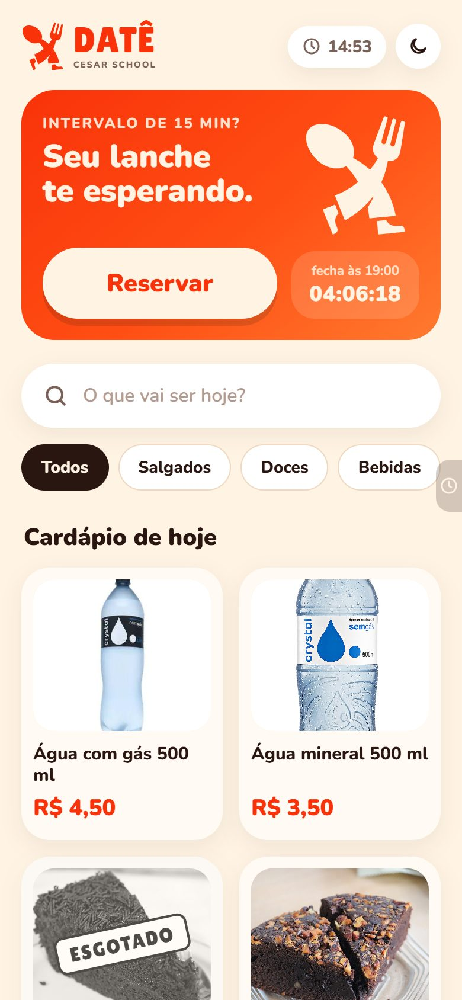
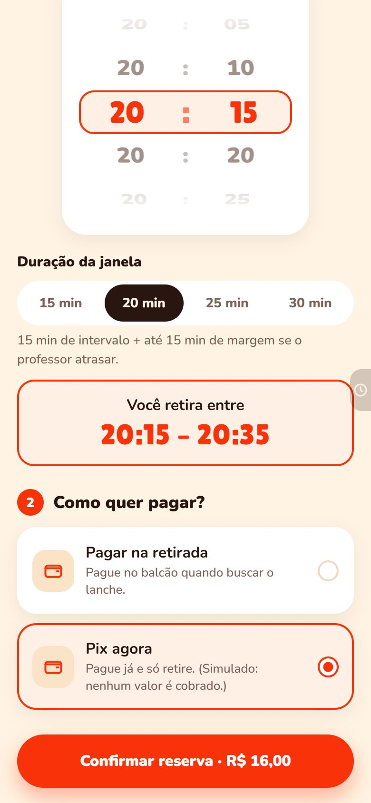
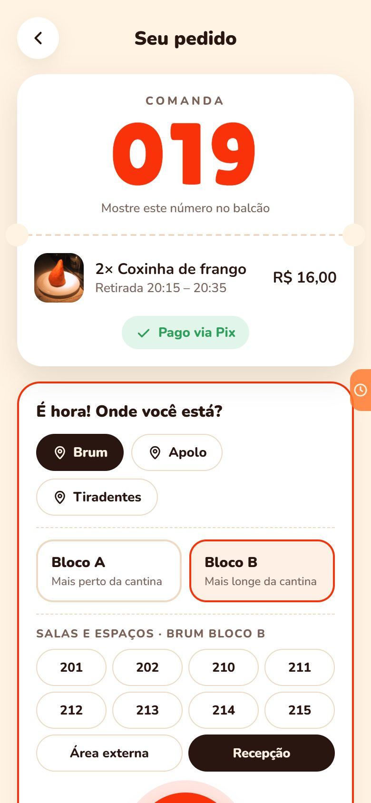
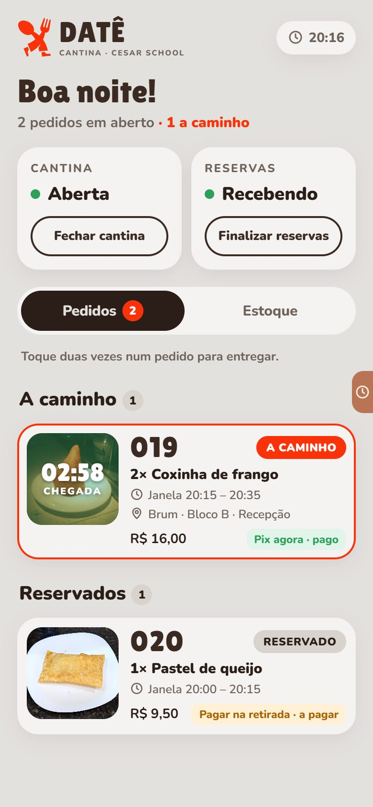
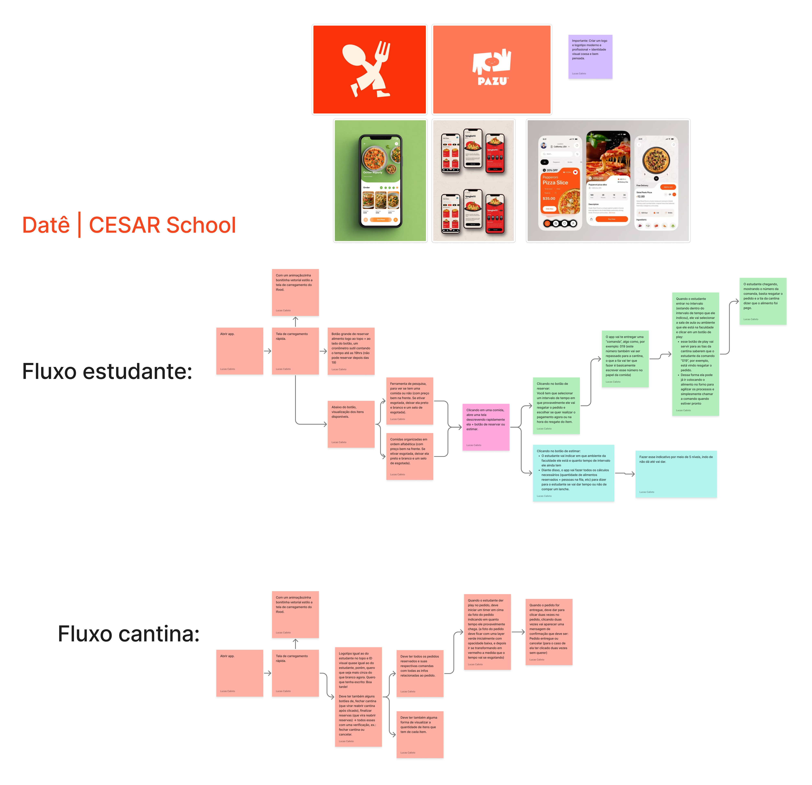
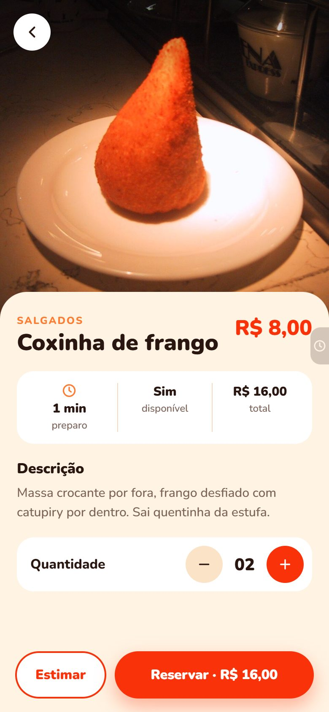
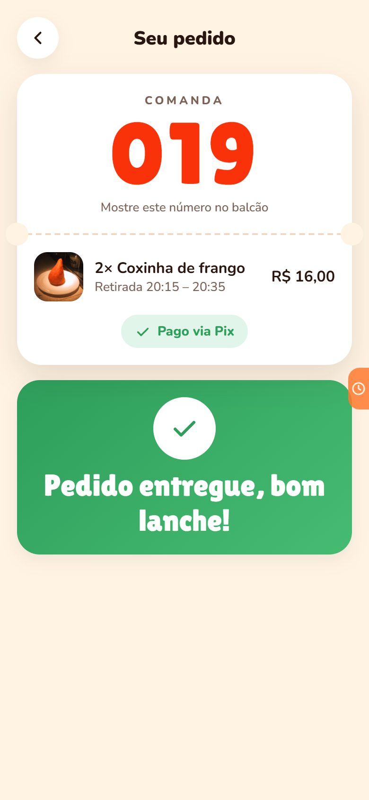
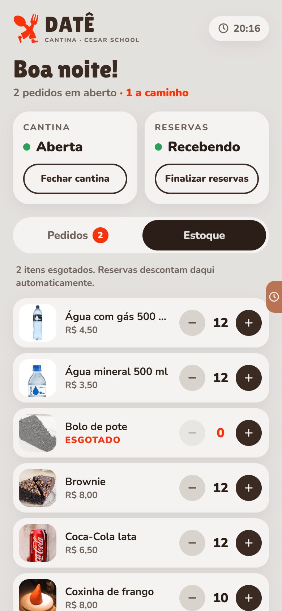
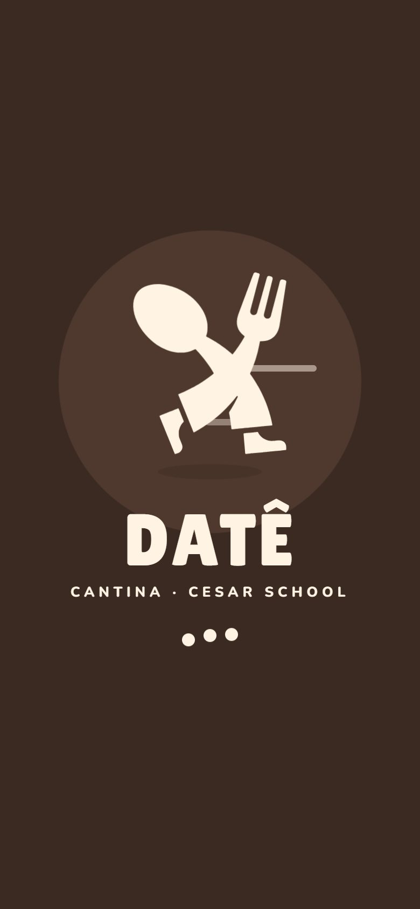

<div align="center">


# DATÊ

**Reserve o lanche da cantina do CESAR e aproveite os 15 minutos de intervalo.**

PoC da disciplina de Fundamentos de Desenvolvimento de Software · CESAR School
Princípios de projeto do cap. 5 de *Engenharia de Software Moderna* (Marco Tulio Valente)

**Equipe:** Lucas Calixto · João Souza · Jullya Medeiros · Marcos Amaral · Leandro Carvalho · Yasmin Lopes · Miguel Cabral
<sub>Projeto idealizado pela equipe inteira.</sub>

<br />

&nbsp;
&nbsp;
&nbsp;


</div>

## O que é

São dois apps que funcionam juntos:

- **Aluno:** reserva um item até as 19h e escolhe a janela em que deve ser o intervalo (20:00–21:15, de 15 a 30 min). Paga via Pix (simulado) ou na retirada e recebe uma **comanda** (ex.: `019`). Na hora do intervalo, diz onde está e aperta **play**, o "estou indo buscar". Também pode **estimar** se dá tempo de ir ao balcão.
- **Cantina:** vê os pedidos em tempo real, com um **timer de chegada** sobre a foto, que vai do verde ao vermelho. Marca o pedido como entregue com um duplo clique, controla o **estoque** e pode **fechar a cantina** ou **finalizar as reservas**.

É uma prova de conceito: sem backend nem banco de dados. Os dois apps sincronizam entre abas do mesmo navegador.

## Antes do código: o board

Antes de escrever a primeira linha, desenhamos os dois fluxos num board: **estudante** e **cantina**, tela por tela, com as regras de cada passo e as referências visuais. Ele foi o nosso "contrato" com o produto. Cada nota virou uma tela ou uma regra do domínio:

<div align="center">
<a href="docs/board/board-fluxo-date.pdf"></a>
<br />
<sub>Clique para abrir o <a href="docs/board/board-fluxo-date.pdf">PDF do board</a> em alta resolução.</sub>
</div>

| Nota do board | Onde virou código |
|---|---|
| Botão de reservar com cronômetro até as 19h | [`HorarioLimiteDeReserva`](src/core/dominio/reserva/HorarioLimiteDeReserva.ts) com `Relogio` injetável |
| Busca e lista em ordem alfabética; esgotado em preto e branco | [`ConsultaDeCardapio`](src/core/dominio/cardapio/ConsultaDeCardapio.ts) |
| Escolher o intervalo e a forma de pagamento | [`JanelaDeRetirada`](src/core/dominio/reserva/JanelaDeRetirada.ts) + [`pagamento/formas/`](src/core/dominio/pagamento/formas) |
| Comanda (ex.: 019) | [`GeradorDeComanda`](src/core/dominio/comanda/GeradorDeComanda.ts) |
| Play "estou indo buscar", saindo de uma sala | [`ServicoDeRetirada`](src/core/dominio/cantina/ServicoDeRetirada.ts) + [`MapaDoCampus`](src/core/dominio/campus/MapaDoCampus.ts) |
| Estimar em 5 níveis, de "não dá" até "vai dar" | [`EstimadorPorComposicao`](src/core/dominio/estimativa/EstimadorPorComposicao.ts) + [`ClassificadorDeChance`](src/core/dominio/estimativa/ClassificadorDeChance.ts) |
| Cantina: fechar/reabrir e finalizar reservas, com confirmação | [`RegraDeReserva`](src/core/dominio/reserva/RegraDeReserva.ts) + [`PainelDaCantina`](src/apps/cantina/telas/PainelDaCantina.tsx) |
| Timer sobre a foto, do verde ao vermelho | o **mesmo** estimador do aluno, em [`ServicoDeAtendimento`](src/core/dominio/cantina/ServicoDeAtendimento.ts) |
| Duplo clique → "Pedido entregue" ou "Cancelar" | [`ListaDePedidos`](src/apps/cantina/componentes/ListaDePedidos.tsx) |
| Quantidade de cada item | [`ControleDeEstoque`](src/core/dominio/cantina/ControleDeEstoque.ts) |

## Como rodar

Requer **Node 18+**.

```bash
npm install
npm run dev     # abra http://localhost:5173
npm test        # 136 testes (Vitest)
```

| Rota | App |
|---|---|
| [`/aluno`](http://localhost:5173/aluno) | App do aluno |
| [`/cantina`](http://localhost:5173/cantina) | App da cantina |

Abra os dois em **abas do mesmo navegador**: o que acontece em um aparece no outro. A abinha na lateral dos apps simula o horário (por exemplo, 20:00 para liberar o play) e tem o botão **Resetar teste**, que zera tudo nos dois apps.

## Onde estão os princípios

Cada ponto de projeto está marcado no código com `// PRINCÍPIO: <nome> — <por quê>` (37 arquivos). Os principais:

| Princípio | Onde | Comprovado em |
|---|---|---|
| **Ocultamento de Informação** | [`JanelaDeRetirada`](src/core/dominio/reserva/JanelaDeRetirada.ts) se valida sozinha e a tela só pergunta quais opções existem; o mesmo vale para [`Dinheiro`](src/core/dominio/compartilhado/Dinheiro.ts) e `HoraDoDia` | [`JanelaDeRetirada.test.ts`](src/core/dominio/reserva/JanelaDeRetirada.test.ts) |
| **Responsabilidade Única** | [`GeradorDeComanda`](src/core/dominio/comanda/GeradorDeComanda.ts), [`HorarioLimiteDeReserva`](src/core/dominio/reserva/HorarioLimiteDeReserva.ts); calcular o tempo e classificar a chance ficam em classes separadas ([`ClassificadorDeChance`](src/core/dominio/estimativa/ClassificadorDeChance.ts)) | [`Estimativa.test.ts`](src/core/dominio/estimativa/Estimativa.test.ts) |
| **Aberto/Fechado** | Forma de pagamento nova = **criar uma classe** em [`pagamento/formas/`](src/core/dominio/pagamento/formas), descoberta automaticamente, sem `if`/`switch` por tipo; regras de bloqueio da reserva combinadas numa só ([`RegraDeReserva`](src/core/dominio/reserva/RegraDeReserva.ts)) | [`ServicoDeReserva.test.ts`](src/core/dominio/reserva/ServicoDeReserva.test.ts) |
| **Substituição de Liskov** | Um único teste de contrato para todas as formas de pagamento e outro para as duas implementações da sincronização (memória × entre abas) | [`FormaDePagamento.contrato.test.ts`](src/core/dominio/pagamento/FormaDePagamento.contrato.test.ts), [`ArmazemDaCantina.contrato.test.ts`](src/core/infra/armazem/ArmazemDaCantina.contrato.test.ts) |
| **Inversão de Dependências** | O domínio define interfaces (`CardapioRepository`, `Relogio`, [`ArmazemDaCantina`](src/core/dominio/sincronizacao/ArmazemDaCantina.ts)); só a [raiz de composição](src/core/composicao/composicao.ts) conhece as classes concretas | [`integracao.test.ts`](src/core/composicao/integracao.test.ts): o mesmo roteiro passa com as duas implementações |
| **Segregação de Interfaces** | `ServicosDoAluno` × `ServicosDaCantina`; leitura × controle da cantina e do estoque ([`portas.ts`](src/core/dominio/cantina/portas.ts)) | [`arquitetura.test.ts`](src/arquitetura.test.ts): nenhum app importa o outro |
| **Lei de Demeter** | [`Pedido`](src/core/dominio/pedido/Pedido.ts) tem `estaPago()`, `numeroDaComanda()` e não expõe a cobrança, o item nem a janela | [`Pedido.test.ts`](src/core/dominio/pedido/Pedido.test.ts) |
| **Composição em vez de Herança** | [`EstimadorPorComposicao`](src/core/dominio/estimativa/EstimadorPorComposicao.ts) soma componentes (fila, preparo, deslocamento) e é o **mesmo** que calcula o timer de chegada da cantina | [`Estimativa.test.ts`](src/core/dominio/estimativa/Estimativa.test.ts) |

**Estrutura:**
- `src/core`: domínio em TypeScript puro, adaptadores e composição.
- `src/design`: componentes e temas compartilhados.
- `src/apps/aluno` e `src/apps/cantina`: os dois apps, separados.

Testes de arquitetura garantem essa separação.

O registro honesto do que a IA errou e de como foi corrigido está em [`docs/ia-errou.md`](docs/ia-errou.md).

<div align="center">
<br />
&nbsp;
&nbsp;
&nbsp;


<sub>React · TypeScript · Vite · Vitest &nbsp;·&nbsp; Mascote: Fernanda &nbsp;·&nbsp; Fotos provisórias: <a href="docs/creditos-imagens.md">créditos</a></sub>
</div>
